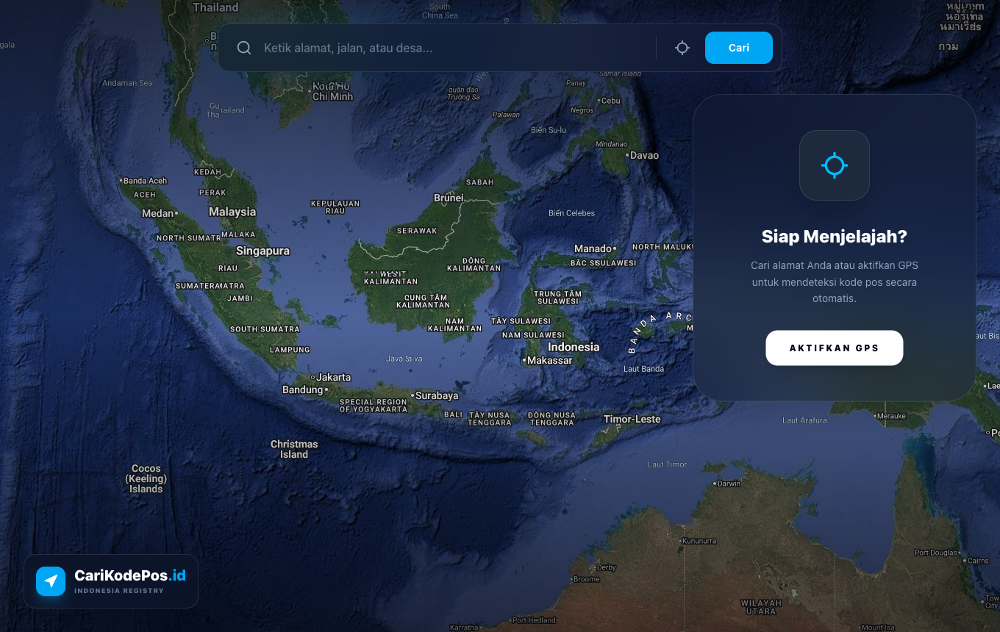

# 🛰️ CariKodePos.id - Indonesian Digital Postal Registry

[](https://react.dev/)
[](https://tailwindcss.com/)
[](https://vite.dev/)
[](LICENSE)
[](https://carikodepos.ksatriabintangsamudra.com)

**CariKodePos.id** adalah aplikasi pencarian kode pos Indonesia tingkat profesional yang menggabungkan presisi data dengan pengalaman visual 3D yang imersif. Dirancang dengan estetika modern dan performa tinggi untuk membantu pengguna menemukan kode pos di seluruh pelosok Indonesia dalam hitungan detik.



**🔗 Live — [carikodepos.ksatriabintangsamudra.com](https://carikodepos.ksatriabintangsamudra.com)**

## ✨ Fitur Unggulan

- 🌍 **Realistic Earth Exploration**: Menggunakan pencitraan satelit resolusi tinggi (Google Hybrid Satellite) yang memberikan detail hingga tingkat atap rumah.
- 🛡️ **100% Data Integrity**: Sistem cerdas yang menggabungkan database lokal (In-Memory) dengan dual-API fallback (Konoland 2025 & Vercel) untuk menjamin akurasi 100%.
- 📍 **GPS Auto-Detector**: Deteksi lokasi real-time dengan satu klik untuk mendapatkan kode pos wilayah Anda saat ini secara otomatis.
- 🌉 **Street View Integration**: Tombol integrasi langsung ke Google Street View untuk melihat kondisi jalan di koordinat terpilih secara visual 360°.
- 💎 **Premium Glassmorphism UI**: Antarmuka futuristik berbasis "Glass-effect" dengan animasi transisi halus menggunakan **Framer Motion**.
- 🔍 **Smart Autocomplete**: Pencarian lokasi cerdas yang tahan typo dan memberikan saran otomatis secepat kilat.

## 🚀 Teknologi yang Digunakan

- **Frontend**: [React 19](https://react.dev/) (Latest)
- **Styling**: [Tailwind CSS v4](https://tailwindcss.com/) (Cutting Edge)
- **Mapping**: [Leaflet.js](https://leafletjs.com/) with Google Hybrid Tiles
- **Animations**: [Framer Motion](https://www.framer.com/motion/)
- **Icons**: [Lucide React](https://lucide.dev/)
- **Build Tool**: [Vite](https://vite.dev/)

## 🛠️ Instalasi & Pengembangan

1. Clone repositori ini:
   ```bash
   git clone https://github.com/Kstriabintang/Indonesian-Zip-Code.git
   ```

2. Masuk ke direktori proyek:
   ```bash
   cd Indonesian-Zip-Code
   ```

3. Instal dependensi:
   ```bash
   npm install
   ```

4. Jalankan mode pengembangan:
   ```bash
   npm run dev
   ```

## 📈 Roadmap Pengembangan

- [x] Integrasi Peta Satelit Google Hybrid.
- [x] Logika In-Memory Search untuk area prioritas (Limbung, Rengat, dll).
- [x] Fitur Smart Autocomplete.
- [ ] Integrasi Database Offline Penuh (PWA).
- [ ] Export data ke format CSV/Excel.
- [ ] Fitur Bookmark lokasi favorit.

## 🤝 Kontribusi

Kontribusi selalu terbuka! Silakan buka *Issue* atau kirimkan *Pull Request* untuk meningkatkan kualitas aplikasi ini.

## 📜 Lisensi

Didistribusikan di bawah Lisensi MIT. Lihat `LICENSE` untuk informasi lebih lanjut.

---

Crafted with ❤️ for Indonesia by [Kstriabintang](https://github.com/Kstriabintang)
